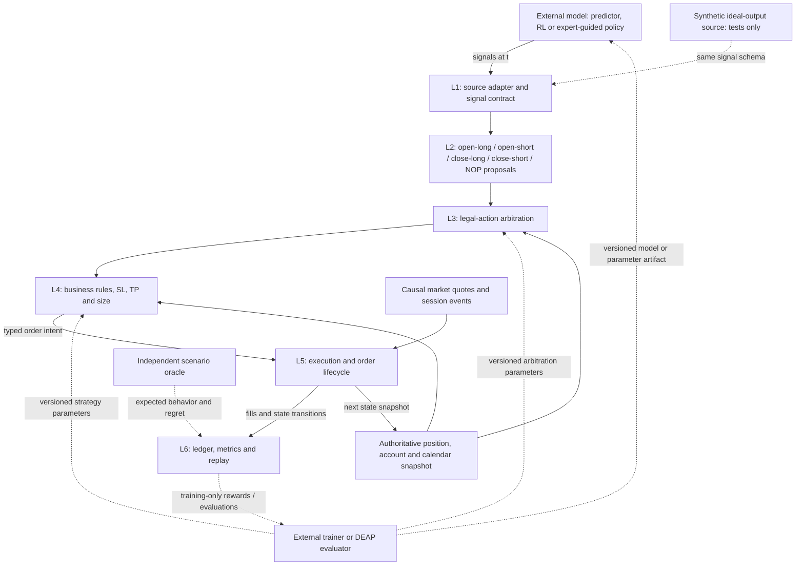
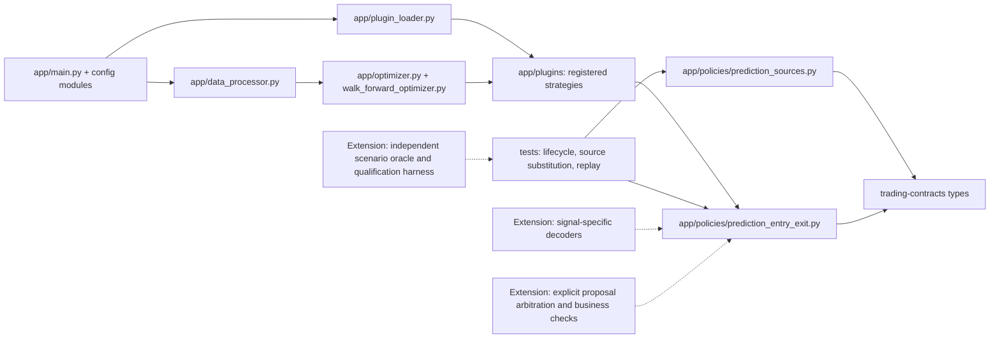
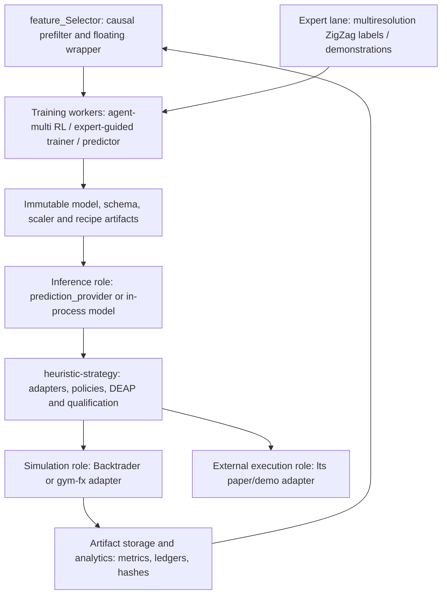

# Heuristic Strategy Optimizer

A Backtrader + DEAP toolkit for backtesting and genetic-algorithm
optimization of trading strategies. Strategies are pluggable via Python
entry points; prediction inputs come either from CSV files or, per tick,
from a running [prediction_provider](https://github.com/harveybc/prediction_provider)
HTTP service. On top of the single-run optimizer the repository carries a
walk-forward optimization (WFO) harness with committed phase results, and it
exports a reusable, contract-typed trade lifecycle policy consumed through
the `trade_lifecycle_policy.plugins` entry-point group.

## Status

**For evaluation:** the [agent guide](AGENTS.md) describes bounded examples.
Prefer the CSV prediction source when reproducing a backtest; an HTTP source
can change with the service or model version. Preserve dataset, prediction,
strategy and cost configurations together. Backtest output does not establish
out-of-sample profitability.

See the [research repository map](https://github.com/harveybc/predictor/blob/master/docs/RESEARCH_STACK.md)
for the upstream data, feature-engineering and representation-learning stages.

**ACTIVE — component repository.** Package `heuristic_strategy` version
**0.1.0** ([`setup.py`](setup.py)). It is a leaf tool: no sibling repository
imports it as a dependency (siblings that show similar code use their own
vendored copies).

**Trading status: backtesting and simulation only.** This repository places
no orders on any venue; the wider stack it belongs to runs in paper/demo
venues only, with real capital not enabled. Nothing here is financial
advice.

## Run this with an AI agent

Paste this into Claude Code, Cursor, Codex, GitHub Copilot or any coding agent with shell access:

> Read `AGENTS.md` in this repository and follow the **Agent quickstart** section end to end: set up the environment, run the smoke test, execute the example backtest, then tell me the exact file paths or URL where I can see the results and one analysis I should try first.

`AGENTS.md` is the [agents.md](https://agents.md) convention, read natively by most coding agents.

## Role and non-responsibilities

**Owns**

- Strategy backtests over historical OHLC data (Backtrader) and GA
  optimization of strategy parameters (DEAP), including anchored
  walk-forward optimization ([`run_wfo.py`](run_wfo.py)).
- The trade lifecycle policy `prediction_entry_exit_v1`
  ([`app/policies/prediction_entry_exit.py`](app/policies/prediction_entry_exit.py),
  [`app/policies/prediction_sources.py`](app/policies/prediction_sources.py)),
  typed with [trading-contracts](https://github.com/harveybc/trading-contracts)
  models and registered under `trade_lifecycle_policy.plugins`.

**Does not own**

- Prediction serving (prediction_provider), live/paper execution
  ([lts](https://github.com/harveybc/lts)), model training
  ([predictor](https://github.com/harveybc/predictor)) or distributed
  optimization ([doin-node](https://github.com/harveybc/doin-node)); this
  repository is not a DOIN network participant.

## Strategy architecture and design method

This section is the shared design contract for prediction-driven strategies,
RL policies and expert-guided policies. It describes **required behavior**, not
a claim that every existing plugin already implements it. Existing code is
mapped separately below. Updating this document does not change a running
experiment, authorize a new model input, or certify a strategy.

The three views follow
[Documenting Software Architectures: Views and Beyond (SEI)](https://www.sei.cmu.edu/library/documenting-software-architectures-views-and-beyond-second-edition/):
component-and-connector views describe runtime interaction, module views
describe code responsibilities, and allocation views place those responsibilities
on repositories and execution resources. These are three **view categories**,
not a guarantee that three diagrams alone specify a system: contracts, timing,
constraints, rationale and evidence are also necessary.

The scope here is the **strategy and its qualification boundary**, with the
surrounding model/data systems shown as context. It is not a redesign of the
whole stack. Training algorithms may differ between the pure-RL and
expert-guided lanes; execution semantics and business constraints must agree.

### Layers and responsibilities

| Layer | Components and responsibility | Boundary |
|---|---|---|
| Upstream, outside strategy | Selected features, encodings, extractors, fusion, core, prediction/RL heads | Produces signals; its internal architecture is a black box to the strategy |
| L1: signal contract | Source adapter, timestamp/schema checks, explicit decoder | Converts named model outputs into typed signals without inventing missing values |
| L2: action proposals | Open-long, open-short, close-long, close-short, abstain/hold evaluators | Each proposes an action and its evidence; may be rules, separate models or a joint policy |
| L3: arbitration | Legal-action mask, comparable utilities, conflict and tie resolution | Chooses one coherent intent, not the first eligible branch in source order |
| L4: business and risk | Calendar, entry limits, SL/TP geometry, volume/margin constraints | Enforces non-negotiable rules independently of the model and optimizer |
| L5: execution | Quote-aware simulator or external execution adapter, order lifecycle | Converts intent to executable orders/fills; maintains authoritative account/order state |
| L6: measurement | Trade ledger, action trace, costs, rewards, evaluation and replay | Records what actually happened; never substitutes requested actions for fills |

Layers are logical responsibilities, not a requirement for six processes or six
new plugin namespaces. The policy may inspect execution context while the
**model observation remains market-only**. Position, entry, SL, TP, balance and
calendar must exist in the simulator; passing them into a neural observation
is a separate experimental choice, not an implicit consequence of this design.

### 1. Component-connector view: runtime

Solid arrows below are runtime data flow; dotted arrows are experiment-only
paths. Each decision uses a timestamped snapshot. The order-state feedback
arrow goes to the strategy, **not** automatically to the signal-producing model.



The source is replaceable: short/long multi-output forecasts, categorical
action scores plus continuous risk heads, or a custom bit-vector protocol.
None is inherently the right representation. The strategy designer first
specifies the decisions it must support, then the information needed to make
them, then the output schema and heads. A network is trained to satisfy that
contract, not used to justify an arbitrary decoder after training.

### Signal and action contracts

Every strategy version must specify these fields in its design/configuration:

| Contract | Required definition |
|---|---|
| Identity | Strategy, signal schema, decoder, model/config hashes, instrument and producer |
| Time | Observation cutoff, availability time, decision time, valid-until time, first executable fill; horizon units and ordered horizon list |
| Fields | Names/order, shapes, units, finite ranges, normalization/inverse transform and missing-value behavior |
| Semantics | Probability vs logit vs price vs return vs distance; calibrated utility units if proposals are compared |
| Decoder | Categorical selection/masking; bit order and invalid bit patterns for custom protocols; transformations and parameter bounds |
| Failure behavior | Reject malformed/stale signals, prevent new exposure, retain broker protections and compulsory-exit handling; log the reason |

For two forecasting models, the short and long arrays must identify each
horizon and whether its value is a price or a return. An index is not a time
unit. A handful of future endpoints does **not** specify the intrabar path or
which of TP/SL is hit first. If that ordering is needed, the contract must
provide more information or declare uncertainty and a conservative rule.

A categorical action head is not a Gaussian scalar rounded into five classes.
Continuous heads are appropriate for explicitly continuous quantities. A
64-bit vector, or 128 bits plus 16 continuous values, is acceptable only with
a versioned decoder, legal-code tests and demonstrated information sufficiency.
Extra output dimensions alone do not establish that sufficiency.

| Action | Preconditions | Required output / effect |
|---|---|---|
| `OPEN_LONG` | Entry permitted, no conflicting position, affordable valid order | Positive size, buy entry, SL below entry and TP above entry |
| `OPEN_SHORT` | Same checks, evaluated symmetrically | Positive size, sell entry, TP below entry and SL above entry |
| `CLOSE_LONG` | Identified existing long position | Close that position at an executable liquidation quote |
| `CLOSE_SHORT` | Identified existing short position | Close that position at an executable liquidation quote |
| `NOP` / `HOLD` | Flat / already positioned respectively | No discretionary new order / retain position; protections and compulsory exits remain active |

These are semantic actions, not new enum values asserted to exist in
`trading-contracts`. Adapters map them to that package's actual intent types.
The initial single-position design does not allow implicit reversal, stacking,
partial closure or same-tick close-and-reopen. Those require explicit variants.
NOP need not have its own network: it may be a categorical action or the
arbitrator's decision when no permitted proposal has enough net benefit.

The arbitrator evaluates **both** eligible entry directions before choosing.
It compares like-for-like utilities, with a declared tie/abstention rule.
Probabilities from separately trained specialists are not automatically
comparable. HOLD competes with CLOSE for an existing position, rather than
comparing a close score to an unrelated new-entry score. No trade-count bonus
may override legality or force an otherwise rejected trade.

For an entry, a versioned strategy computes strictly positive distances
`d_sl` and `d_tp` from its signals and configured coefficients. With direction
`s = +1` for long and `s = -1` for short:

```text
SL = executable_entry - s * d_sl
TP = executable_entry + s * d_tp
volume_fraction v in [0, 1]
requested_margin_budget = v * rel_volume * balance(t)
```

In the current business design, `rel_volume = 0.1` is the configurable maximum
balance fraction per order: `v = 1` requests that budget, not the whole balance;
`v = 0.2` requests one fifth of it. It is a margin allocation, **not** a claim
that loss at SL equals that fraction. The broker adapter converts it to units
using leverage, contract size, quote/account currency conversion and instrument
rules, rounds down to the size step and checks available margin and loss risk.
Zero means no entry; an unaffordable minimum lot is rejected, not rounded up
beyond the budget. Distances must satisfy broker minimums before submission.

Buy fills use ask and long liquidation uses bid; sell fills use bid and short
liquidation uses ask. Spread, commissions, slippage and financing must be
accounted once. Gaps and ambiguous OHLC barrier ordering need an explicit
execution rule. The calendar enforces closure 12 hours before the scheduled
market close and no reopening until 12 hours after market reopening, with
timezone/DST and holidays explicit. Entry-frequency limits are fixed by the
experiment's business contract, not inferred from legacy defaults.

At each tick, reconcile fills/protections that already happened, enforce
mandatory actions, evaluate signals and discretionary actions, then execute
at the declared next executable time. A close decision cannot undo an SL hit
before its fill. Missing predictions do not disable compulsory liquidation.

### Early close: a separate conditional optimization problem

An entry oracle chooses **whether, when and in which direction to open**.
An early-close oracle starts with an **already open, fixed position**. Its
entry, direction, volume, SL and TP cannot be changed to improve the score.

For a decision at `t`, define `tau` as the first automatic termination under
HOLD: SL, TP, compulsory calendar exit, margin liquidation or the declared
scenario boundary. Let `E(t)` be the legal discretionary fill opportunities
from now until that termination, respecting execution latency and barrier
priority. Let `N(u)` be net liquidation P&L at such a fill, including costs,
and `N_auto(tau)` the net outcome of automatic termination. Then:

```text
V*(t) = max({N(u): u in E(t)} union {N_auto(tau)})
regret(t, chosen_exit) = V*(t) - N(chosen_exit)
normalized_regret = regret / initial_cash_risk_at_SL
```

The denominator is positive, frozen at entry; invalid/zero risk is a contract
error. The tie policy is declared (for example, earliest executable optimum).
When the counterfactual reaches SL before TP, this searches the best net exit
**between the current decision and that first SL**, not the entry pivot, a peak
already passed, or a recovery after SL. An earlier TP/mandatory exit bounds the
search. If no discretionary fill is possible, the case tests protection
priority, not a missed early-close opportunity.

Compare closing now against the best feasible continuation. Merely predicting
an eventual SL does not make immediate closure optimal. Test loss reduction,
profit preservation, profitable HOLD, late and premature exits in both
directions. Historical early-close percentages are descriptive, not quotas.
This oracle uses future prices **only in synthetic tests or training labels**;
the deployed policy never receives those future observations.

There is no universal best action without a declared objective, constraints
and execution clock. Likewise, a sum of locally optimal exits does not prove
globally optimal portfolio Sharpe: re-entry opportunities and exposure couple
decisions. Test the isolated actions first, then their full composition.

### 2. Module view: implementation and ownership

Solid dependencies describe modules in this checkout; dotted links describe
extension contracts, **not implemented new packages or entry points**.



The policy dependency applies to the prediction-entry/exit implementation,
not a claim that every plugin delegates to it. The existing policy implements
forecast geometry, early-exit variants A-G and legacy sizing. Its defaults
include `rel_volume=0.02` and a five-day entry limit; those are **legacy values**,
not the business settings specified above. Its `_finite_path` removes
non-finite values, and its direction tie favors long. Neither behavior is a
universal signal-contract/arbitration rule. The generic schema validator,
mandatory calendar enforcement and symmetric tie handling described here must
be demonstrated for each concrete consumer; this README does not retrofit them.

Use the existing `heuristic_strategy.plugins` and
`trade_lifecycle_policy.plugins` extension mechanisms and JSON merge path.
Do not invent a parallel plugin framework. New adapters must preserve the
registered interfaces or introduce an explicitly versioned contract.

### 3. Allocation view: repositories and execution roles

This is the target integration allocation, not a statement that every runtime
link is deployed. Hardware placement is configurable, not part of correctness.



| Allocation | Responsibility / isolation |
|---|---|
| CPU coordinator | Configuration, deterministic scenario generation, manifests, queue/resume and audit orchestration |
| GPU training worker | Model fitting and declared inference workloads; serial admission when memory requires it |
| Simulator worker | Pinned execution engine, independent accounting checks and complete action/trade traces |
| Artifact/analytics storage | Immutable inputs/results, effective configuration, seeds, hashes and metric definitions |
| Expert-guided lane | Teacher construction and learning objectives; no retrospective teacher values in live observations |
| Pure-RL lane | Rewards and learning from environment interaction; no ZigZag teacher required |

ZigZag-derived supervision belongs upstream of L1 in the **training plane**.
Its labels require horizon/confirmation censoring and temporal purging. It
does not change the execution contract, nor become a live strategy input.
Algorithm names must match the implementation: expert-generated supervision
is not automatically human-feedback RL, and a PPO run is not SAC.

### Test-led design, optimization and feature selection

Descend from requirements to expected behavior before implementation, then
ascend through component, integration and end-to-end evidence. The shared
process is:

1. **Freeze the business contract and use cases.** Define timing, costs,
   position states, allowed actions, constraints and objective semantics.
2. **Design the signal contract.** Determine which information distinguishes
   required actions, its encoding, heads and legal ranges. If identical
   observable inputs and legal masks require contradictory actions, expose
   that aliasing; an oracle alone cannot prove the task is learnable.
3. **Write expected behaviors independently.** Construct scenario fixtures and
   an independent accounting/action oracle before tuning strategy coefficients.
4. **Implement bottom-up.** Test decoder, proposals, arbitration, risk geometry,
   lifecycle and execution; then compose them. Expected results are not
   rewritten to accommodate a defective implementation.
5. **Optimize the strategy with ideal/simulated outputs.** DEAP searches only
   declared coefficients within a fixed schema. Hard constraints reject a
   candidate before scoring. Keep separate calibration, selection and unseen
   synthetic confirmation panels, paired controls and multiple seeds.
6. **Prove the model-to-strategy connection.** Use the real observation encoder,
   policy heads, decoder and simulator on a planted learnable task. Verify
   legal action reachability, gradients/updates, CLOSE and HOLD learning,
   both directions and saved-weight replay. Ideal-input success is not this
   learned positive control. Report the two separately.
7. **Run model-specific floating selection.** After the strategy and learned
   control pass, freeze their versions. Train the actual RL architecture for
   each candidate subset, remove/restore columns or semantic blocks and
   rebuild empty branches. Use paired support, seeds and budgets, TRAIN-only
   transforms and internal chronological validation; TEST remains untouched.
8. **Optimize the selected model and continue the master plan.** Preserve the
   strategy/output contract while tuning the learner. A change in actions,
   reward, execution, decoder or strategy parameters creates a new identity
   and requires affected controls and subset comparisons to be revalidated.

Floating selection must use the same intended learner and temporal modular
representation, not substitute an easier MLP/proxy. State-feedback inputs,
rolling z-score, clipping or new transformations are not authorized by this
architecture. A feature is not removed simply because its marginal score is
weak: the wrapper tests conditional benefit, redundancy and restoration.
Changing an output schema or horizon is an outer design experiment, not a
hidden gene in an otherwise fixed comparison.

#### Scenario coverage and required evidence

Generate a versioned, finite Cartesian panel over declared levels/ranges;
report covered cells and exclusions. A finite suite cannot prove every
continuous market trajectory. Supplement the grid with seeded stochastic,
boundary and adversarial cases; never label a limited panel "all markets".

| Axes / initial conditions | Expected behaviors to assert before running |
|---|---|
| Up/down/flat drift; several strengths and horizons; abrupt/gradual, repeated changes | Correct direction under designed signals; no buy-first routing; correct NOP/HOLD |
| Low/high/changing volatility; overlapping frequencies; noise and shocks | Risk-aware size/abstention; no hidden clipping or accidental action starvation |
| Flat, long, short; positions in loss, at break-even, in profit; varied entry ages | Independent open/close tests; close scenarios do not depend on successful entry learning |
| SL-first, TP-first, reversal then recovery, recovery only after SL | Local early-exit optimum, profitable HOLD and no use of post-termination extrema |
| Gaps, spread/fees/financing, latency, lot/margin boundaries, ambiguous bars | Executable fills, protection priority and independent net-P&L agreement |
| Session edges, holidays, DST, missing/stale/malformed signals | Forced exit and no prohibited entry; no fabricated missing values |
| Ideal, noisy, delayed, contradictory and permuted outputs; swapped direction channels | Decoder correctness, failure handling, sensitivity and negative controls |

Seed an already-open position to test each closer in isolation. For openers,
freeze the downstream exit rule; for sizing, fix entry/exit decisions. Then
test the combined lifecycle with its normal endogenous state. Mirror prices
and swap direction channels/parameters to test symmetry, allowing only
documented asymmetry from quotes, financing or other business rules.

Keep **RL reward**, **DEAP fitness**, and **reported trading performance**
separate. Compare promising fitness variants (Sharpe; Sharpe plus normalized
net return; declared multi-objective alternatives) with fixed scales and a
common selection criterion. Do not select Sharpe-only by asking which arm
maximized its own calibration Sharpe. Minimum activity is a qualification
condition, not unlimited payment for opening orders. Zero variance, zero
trades and invalid seeds must be explicitly represented, not converted to a
favorable score. Report uncertainty and matched differences against untuned
controls; do not claim a significant gain from a point estimate alone.

Each run retains the effective JSON; all tunable names, units, bounds and
fixed constraints; DEAP population/generations/patience/tolerance/operators;
seeds; scenario and support hashes; engine/model identities; and replay
receipts. Record TRAIN and internal/held-out evaluation separately: net return,
profit, Sharpe convention, drawdown, orders/day/week, long/short counts and
win rates, cost breakdown, exit reasons, HOLD/NOP and rejected actions,
close-opportunity capture and net exit regret by direction/scenario.

| Requirement ID | Traceable test / acceptance evidence |
|---|---|
| STR-01: output meaning and causality | Schema/decoder boundaries, timestamp alignment, future-perturbation and source substitution |
| STR-02: legal symmetric actions | Mask/transition tests, both-directions proposals, tie and mirror controls |
| STR-03: SL/TP/volume/business rules | Quote geometry, lot/margin/calendar and cost-accounting fixtures |
| STR-04: optimal conditional early close | Seeded positions, independent executable exit menus, local regret and HOLD counterexamples |
| STR-05: composition | End-to-end synthetic lifecycle and engine-to-reference ledger comparison |
| STR-06: useful optimization | Frozen-panel paired controls, multiple seeds, unseen confirmation and parameter-bound diagnostics |
| STR-07: learned controllability | Planted-task learning through actual heads/decoder; save/reload behavior parity |
| STR-08: reusable feature evaluation | Frozen consumer identity, paired subset fits, removal/restoration and untouched TEST |

These rows specify required evidence, not current PASS results. Each campaign
must link them to actual artifacts and verdicts. Mathematical game-theoretic
or mechanism-design models can help define specialist utilities and arbitration,
but are optional experiments, not substitutes for these observable contracts.

## Existing plugin reference

The CLI ([`app/main.py`](app/main.py)) merges configuration (defaults →
`--load_config` JSON → CLI flags), loads one strategy plugin from the
`heuristic_strategy.plugins` group and runs the backtest/GA pipeline
([`app/optimizer.py`](app/optimizer.py),
[`app/walk_forward_optimizer.py`](app/walk_forward_optimizer.py)).

### Strategy plugins — `heuristic_strategy.plugins` (from `setup.py`)

| Entry point | Module | Description |
|---|---|---|
| `default` | [`app/plugins/plugin_long_short_predictions.py`](app/plugins/plugin_long_short_predictions.py) | CSV-based long/short prediction strategy (hourly + daily prediction files) |
| `ls_pred_strategy` | same module as `default` | Alias registration of the CSV long/short strategy |
| `api_predictions` | [`app/plugins/plugin_api_predictions.py`](app/plugins/plugin_api_predictions.py) | Queries prediction_provider `POST /api/v1/predict/entry` / `POST /api/v1/predict/exit` per tick; `GET /api/v1/model/info` for metadata |
| `direction_atr` | [`app/plugins/plugin_direction_atr.py`](app/plugins/plugin_direction_atr.py) | Direction predictions with ATR-scaled TP/SL geometry |
| `regime_adaptive` | [`app/plugins/plugin_regime_adaptive.py`](app/plugins/plugin_regime_adaptive.py) | Regime-conditional parameter switching |
| `regime_wfo` | [`app/plugins/plugin_regime_wfo.py`](app/plugins/plugin_regime_wfo.py) | Regime strategy variant used by the WFO harness |
| `btc_momentum` | [`app/plugins/plugin_btc_momentum.py`](app/plugins/plugin_btc_momentum.py) | BTC momentum strategy |

### Lifecycle policy plugins — `trade_lifecycle_policy.plugins`

| Entry point | Module | Description |
|---|---|---|
| `prediction_entry_exit_v1` | [`app/policies/prediction_entry_exit.py`](app/policies/prediction_entry_exit.py) | Reusable entry/exit decision policy over prediction sources, emitting trading-contracts-typed decisions |

### Walk-forward optimization harness

[`run_wfo.py`](run_wfo.py) (anchored expanding-window WFO over the 15-year
EURUSD dataset), [`merge_wfo_results.py`](merge_wfo_results.py),
[`deploy_wfo.sh`](deploy_wfo.sh), [`monitor_wfo.sh`](monitor_wfo.sh), and
the phase runners [`run_phase_b_cnn.py`](run_phase_b_cnn.py),
[`run_phase_c_ensemble.py`](run_phase_c_ensemble.py),
[`run_phase_d_neat.py`](run_phase_d_neat.py),
[`run_oracle_ceiling.py`](run_oracle_ceiling.py). Their committed outputs
(`phase_b_cnn_results.json`, `phase_c_ensemble_results.json`,
`phase_d_neat_results.json`, `oracle_ceiling_results.json`, matching
`*_trades.csv`, [`phase_d_neat_configs/`](phase_d_neat_configs/)) are
historical experiment records.

## Requirements

- Python: no `python_requires` declared in [`setup.py`](setup.py); verified
  with **Python 3.12.13** (backtrader 1.9.78.123, deap 1.4).
- [`setup.py`](setup.py) declares only `trading-contracts>=0.1.0`; the
  working dependency set (backtrader, deap, pandas, numpy, requests, …) is
  in [`requirements.txt`](requirements.txt) — which currently contains one
  malformed line (see [Limitations](#limitations)).

## Installation

```bash
git clone https://github.com/harveybc/trading-contracts.git
git clone https://github.com/harveybc/heuristic-strategy.git
pip install -e ./trading-contracts
cd heuristic-strategy
pip install backtrader deap pandas numpy requests matplotlib
pip install -e .
```

Not re-executed in a clean environment for this document (unverified).
The package installs a generic top-level package named `app`, which can be
shadowed by sibling repositories in a shared environment — run from the
repository root with `PYTHONPATH=./` (as [`heuristic.sh`](heuristic.sh)
does) or use a dedicated virtual environment.

## Smallest working example

From the repository root:

```bash
PYTHONPATH=./ python app/main.py --help    # verified: exits 0, prints CLI reference
python run_wfo.py --help                   # verified: exits 0, prints WFO options
```

A short CSV-only backtest (no service required, verified: exits 0 in ~6 s,
writes `run_out/trades.csv`, `run_out/summary.csv` and the balance plot):

```bash
mkdir -p run_out
PYTHONPATH=./ python app/main.py --plugin ls_pred_strategy \
  --base_dataset_file tests/data/phase_2_3_base_d3.csv \
  --hourly_predictions_file tests/data/phase_2_3_cnn_1h_prediction_d3.csv \
  --daily_predictions_file tests/data/phase_2_3_cnn_1d_prediction_d3.csv \
  --population_size 2 --num_generations 1 \
  --trades_csv_file run_out/trades.csv --summary_csv_file run_out/summary.csv \
  --balance_plot_file run_out/balance_plot.png \
  --save_parameters run_out/parameters.json --save_config run_out/config_out.json
```

The dataset paths must be given explicitly: the defaults in
[`app/config.py`](app/config.py) use Windows separators (`tests\data\...`) and
do not resolve on Linux. Create the output directory first — the app does not.

A two-fold walk-forward run needs no predictions at all (verified: 17 s):

```bash
python run_wfo.py --train_years 1 --first_test_year 2009 --last_test_year 2010 \
  --population_size 4 --num_generations 1 --min_trades 1 \
  --save_results run_out/wfo_results.json --save_trades run_out/wfo_trades.csv
```

A repository-owned end-to-end config is
[`config_direction_atr_cnn.json`](config_direction_atr_cnn.json): it runs the
`direction_atr` plugin over the committed dataset
[`tests/data/phase_1c_direction_test_ohlc.csv`](tests/data/phase_1c_direction_test_ohlc.csv)
with `prediction_source: "API"`, so it additionally requires a local
prediction_provider instance listening on port 8000 (execution unverified
for this document):

```bash
PYTHONPATH=./ python app/main.py --load_config config_direction_atr_cnn.json
```

## Tests and validation

```bash
python -m pytest tests -q --continue-on-collection-errors
```

Observed result: `26 passed, 8 failed, 8 errors`. The collection errors come
from stale test modules that still import an autoencoder-era API
(`app.autoencoder_manager`, encoder plugins) which no longer exists; the
failures are in `tests/unit_tests/test_prediction_client.py` and
`tests/integration_tests/test_configuration_handling.py`. The healthy subset —
the trade lifecycle policy, its prediction sources and the backtrader replay —
passes cleanly:

```bash
python -m pytest tests/unit_tests/test_prediction_entry_exit_policy.py \
                 tests/unit_tests/test_prediction_source_substitution.py \
                 tests/unit_tests/test_prediction_entry_exit_backtrader_replay.py -q
# observed: 17 passed
```

Collecting from the repository root instead of `tests/` additionally pulls in
the vendored `timeseries-gan/tests` and fails — always pass the `tests` path.

## Artifacts, data and outputs

- Inputs: OHLC and prediction CSVs under [`tests/data/`](tests/data/).
- Outputs: optimized parameters (`config_*_out.json`,
  [`parameters.json`](parameters.json)), balance plots, debug logs and the
  committed WFO/phase result JSON + trade CSV files listed above.
- Reproducibility: GA runs are stochastic; committed result files record
  the outcomes of specific historical runs and are not regenerated
  automatically.

## Safety, security and credentials

No credentials are used or stored; the only network access is to a
locally-run prediction_provider URL supplied via `pp_api_url`. Backtesting
only — no venue connectivity, no capital at risk, not financial advice.

## Limitations

- **Vendored `timeseries-gan/` subtree.** A full copy of the legacy
  [timeseries-gan](https://github.com/harveybc/timeseries-gan) project
  (predecessor of
  [synthetic-datagen](https://github.com/harveybc/synthetic-datagen)) may
  be present locally at `timeseries-gan/` — a gitignored working-tree
  directory, not committed to this repository's history. When present it
  is not part of the installed package, breaks root-level pytest
  collection, and its `LICENSE.txt` applies to that subtree only.
- **Stale test modules.** Part of `tests/` predates the current codebase
  and fails collection (8 errors, see above).
- **Malformed `requirements.txt`.** It contains the line
  `pytestpip install graph` (a corrupted merge of `pytest` and a pip
  command); install dependencies individually as shown above. It also omits
  `matplotlib`, which `app/heuristic_strategy.py` imports at module level.
- **Declared vs. actual dependencies.** `setup.py` declares only
  `trading-contracts`; Backtrader/DEAP and the rest must be installed
  separately.
- **The balance plot is written to `./balance_plot.png` and then moved** to
  `--balance_plot_file`, so a run overwrites (or, on a successful move,
  removes) the committed root `balance_plot.png`; the move also fails across
  filesystems. Keep the output directory inside the repository and restore the
  file with `git checkout -- balance_plot.png`.
- Committed experiment residue at the repository root (result JSONs, trade
  CSVs, `balance_plot.png`, `debug_log_*` outputs, prediction CSV exports)
  is historical record, not documentation.
- No top-level LICENSE file currently exists in this repository.
